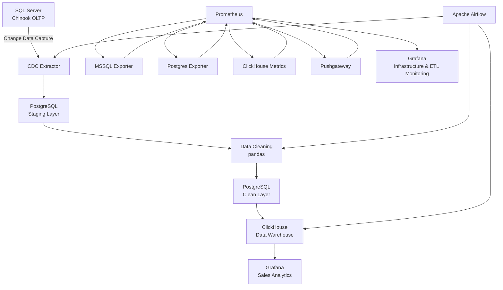
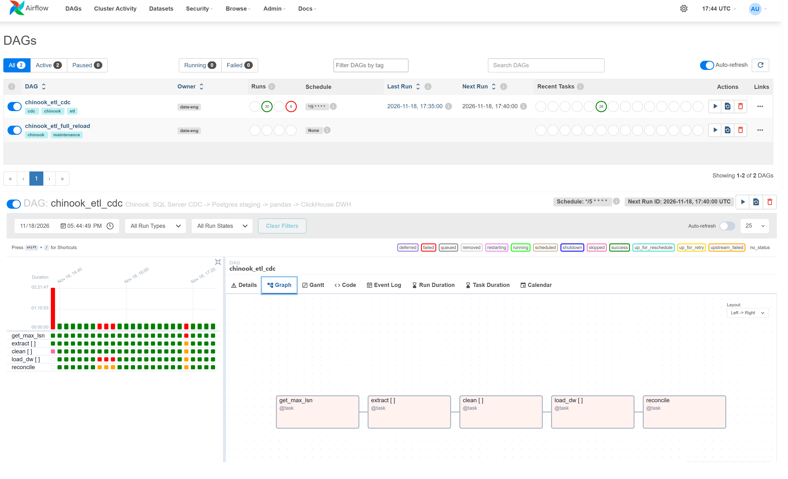
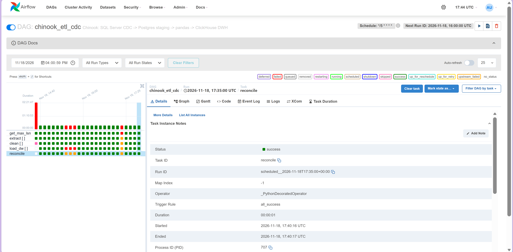
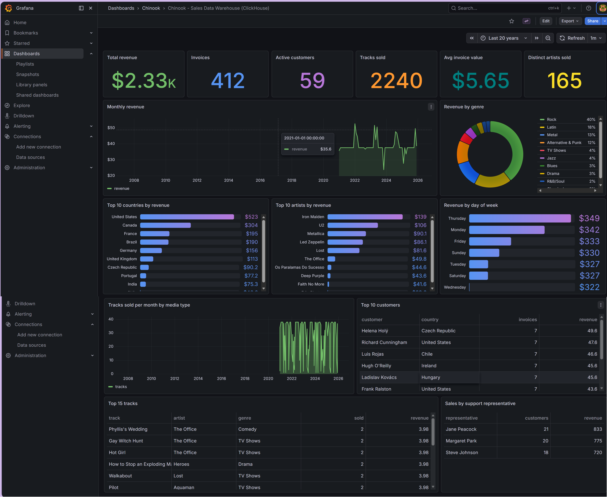
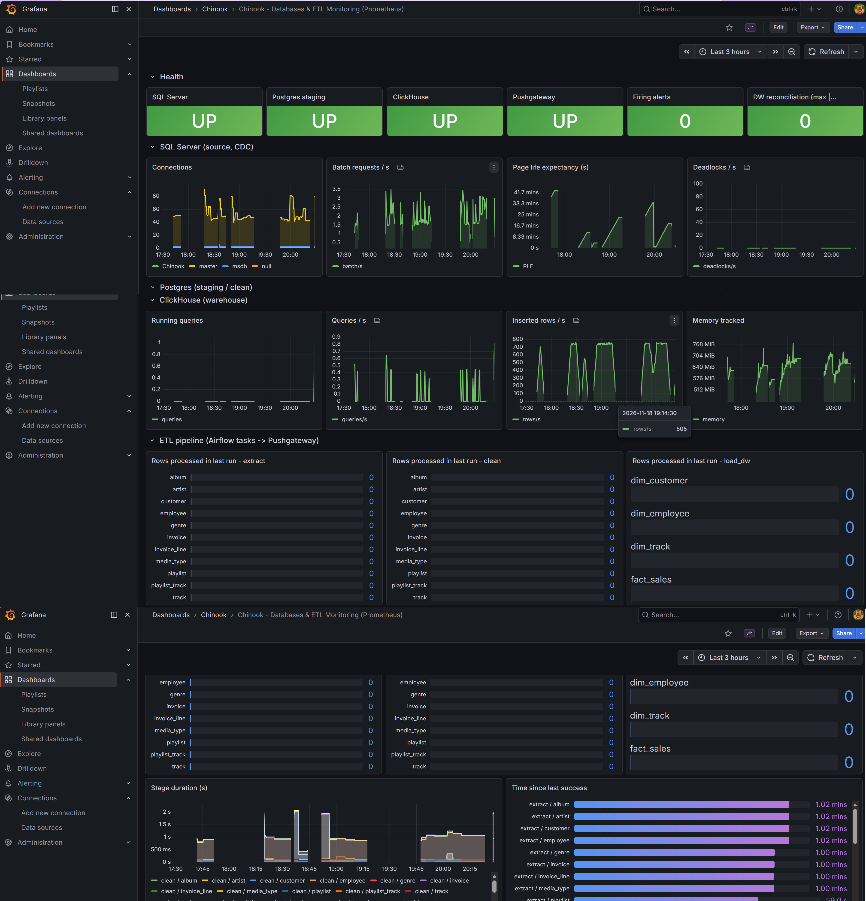

# Chinook ETL Pipeline — CDC-Driven Data Warehouse

An end-to-end data engineering project that transforms transactional data from SQL Server into an analytics-ready Data Warehouse using **Change Data Capture (CDC)**, **Apache Airflow**, **PostgreSQL**, **pandas**, and **ClickHouse**.

The pipeline captures incremental changes, processes and validates data, maintains a dimensional data warehouse, and provides real-time operational monitoring through **Prometheus and Grafana**.

---

## Architecture




## Project Screenshots

### Apache Airflow — ETL Pipeline Orchestration

The CDC pipeline is orchestrated using Apache Airflow and runs automatically every five minutes.



### Airflow — Pipeline Execution

Monitoring individual ETL tasks, execution status, and pipeline runs.



### Grafana — Sales Data Warehouse

Interactive dashboard powered by ClickHouse for analyzing sales data.



### Grafana — Infrastructure & ETL Monitoring

Real-time monitoring of databases, ETL metrics, pipeline health, and data quality.




### Data Flow

```text
SQL Server (Chinook, CDC)
        │
        │ scripts/cdc_extractor.py
        │ Initial Snapshot + Incremental CDC
        ▼
PostgreSQL — staging.*
        │ Append-only CDC log (I / U / D / S)
        │
        │ scripts/cleaner.py
        │ pandas transformation & data quality
        ▼
PostgreSQL — clean.*
        │ Current cleaned state + global _version
        │ etl_control.dq_rejects
        │
        │ scripts/clickhouse_loader.py
        ▼
ClickHouse — dw.*
        │ ReplacingMergeTree(_version, _is_deleted)
        │
        ├── dim_customer
        ├── dim_employee
        ├── dim_track
        ├── dim_date
        └── fact_sales
        │
        ▼
Grafana — Sales Data Warehouse Dashboard
```

### Monitoring Architecture

```text
Prometheus
    ├── SQL Server → mssql-exporter
    ├── PostgreSQL → postgres-exporter
    ├── ClickHouse → Native Prometheus Endpoint (:9363)
    └── ETL Metrics → Pushgateway
            │
            ▼
        Grafana
            └── Databases & ETL Monitoring Dashboard
```

---

## Tech Stack

| Technology | Purpose |
|---|---|
| SQL Server 2022 | Source OLTP database |
| SQL Server CDC | Incremental change tracking |
| PostgreSQL 16 | Staging and cleaned data layers |
| pandas | Data cleaning and transformation |
| ClickHouse 24.8 | Analytical Data Warehouse |
| Apache Airflow 2.10.2 | ETL orchestration and scheduling |
| Docker & Docker Compose | Containerization and service management |
| Prometheus | Metrics collection and alerting |
| Grafana | Data visualization and monitoring |
| Pushgateway | ETL metrics ingestion |
| Python | ETL implementation |

---

## Key Features

- **Incremental ETL with SQL Server CDC**
  - Initial snapshot followed by incremental change extraction.
  - LSN-based watermarks for reliable change tracking.
  - Support for inserts, updates, deletes, and snapshot records.

- **Multi-layer Data Architecture**
  - Append-only staging layer.
  - Cleaned and deduplicated data layer.
  - Analytical Data Warehouse in ClickHouse.

- **Automated Data Quality**
  - Null handling and string normalization.
  - Duplicate detection.
  - Business rule validation.
  - Invalid records quarantined for auditing.

- **Soft Delete Support**
  - Deletions propagated across the pipeline.
  - `_is_deleted` flag maintained in the cleaned layer and Data Warehouse.

- **Version-based Data Synchronization**
  - Global `_version` tracking.
  - Incremental Data Warehouse loading.
  - Consistent handling of dependent dimensions and facts.

- **Idempotent ETL Processing**
  - Safe task retries.
  - Transactional watermark management.
  - Reconciliation between source processing layers.

- **Automated Orchestration**
  - Scheduled CDC pipeline every five minutes.
  - Initial snapshot on first execution.
  - Full reload DAG for recovery.

- **Observability**
  - Database metrics.
  - ETL execution metrics.
  - Data reconciliation metrics.
  - Prometheus alerting rules.
  - Grafana dashboards.

---

## Project Structure

```text
.
├── .env
├── docker-compose.yml
│
├── airflow/
│   ├── Dockerfile
│   └── dags/
│       └── chinook_etl_dags.py
│
├── scripts/
│   ├── common.py
│   ├── cdc_extractor.py
│   ├── cleaner.py
│   └── clickhouse_loader.py
│
├── sql/
│   ├── mssql/
│   │   ├── enable_cdc.sql
│   │   ├── init_mssql.sh
│   │   └── Chinook_SqlServer.sql
│   │
│   ├── postgres/
│   │   └── init_staging.sql
│   │
│   └── clickhouse/
│       └── init_dw.sql
│
├── monitoring/
│   ├── prometheus/
│   │   ├── prometheus.yml
│   │   └── alerts.yml
│   │
│   ├── clickhouse/
│   │   └── prometheus.xml
│   │
│   └── grafana/
│       ├── datasources/
│       │   └── ds.yml
│       │
│       └── dashboards/
│           ├── dashboards.yml
│           ├── chinook_dwh.json
│           └── chinook_monitoring.json
│
└── grafana/
    └── Dockerfile
```

---

## Pipeline Workflow

### 1. CDC Extraction — SQL Server to PostgreSQL Staging

**Script:** `scripts/cdc_extractor.py`

The extraction layer captures changes from SQL Server using CDC.

- Performs an initial snapshot when the pipeline runs for the first time.
- Extracts incremental changes using `cdc.fn_cdc_get_all_changes_dbo_<Table>`.
- Tracks extraction progress using LSN-based watermarks.
- Captures inserts, updates, deletes, and snapshot records.
- Stores CDC events in an append-only staging layer.
- Persists watermarks transactionally in PostgreSQL.

A shared maximum LSN (`get_max_lsn`) is used across tables to ensure a consistent extraction boundary.

### 2. Data Cleaning & Quality — Staging to Clean Layer

**Script:** `scripts/cleaner.py`

The cleaning layer processes CDC events using pandas and maintains the current state of each entity.

Transformations include:

- Trimming and normalizing strings.
- Converting empty strings to `NULL`.
- Lowercasing email addresses.
- Standardizing country names:
  - `USA` → `United States`
  - `UK` → `United Kingdom`
- Rounding monetary values.
- Deduplicating records.
- Applying the latest change per primary key.
- Validating business rules.
- Handling soft deletes.

Invalid records are quarantined in:

```text
etl_control.dq_rejects
```

The cleaned layer maintains a globally incremented `_version` to support downstream synchronization.

### 3. Data Warehouse Loading — PostgreSQL to ClickHouse

**Script:** `scripts/clickhouse_loader.py`

Cleaned data is loaded into ClickHouse using version-aware tables based on:

```sql
ReplacingMergeTree(_version, _is_deleted)
```

The Data Warehouse contains:

- `dim_customer`
- `dim_employee`
- `dim_track`
- `dim_date`
- `fact_sales`

Analytical views are provided through:

```text
dw.v_*
```

These views handle the latest record versions and soft-deleted rows.

### 4. Data Reconciliation

After every Data Warehouse load, the pipeline reconciles row counts between PostgreSQL and ClickHouse.

If a discrepancy is detected:

- The ETL task fails.
- The reconciliation difference is recorded.
- The `etl_reconciliation_diff` metric is emitted.
- An alert can be triggered through Prometheus.

---

## Airflow Orchestration

The project includes two DAGs:

| DAG | Description |
|---|---|
| `chinook_etl_cdc` | Incremental CDC pipeline |
| `chinook_etl_full_reload` | Full reload and recovery pipeline |

The main CDC DAG is scheduled to run every **5 minutes**.

The first execution automatically performs an initial snapshot before transitioning to incremental processing.

---

## Monitoring & Observability

### Prometheus

Prometheus collects metrics from:

- SQL Server — `mssql-exporter`
- PostgreSQL — `postgres-exporter`
- ClickHouse — native Prometheus endpoint on port `9363`
- ETL scripts — Pushgateway

### ETL Metrics

The pipeline exposes metrics including:

```text
etl_rows_processed
etl_stage_duration_seconds
etl_last_success_timestamp_seconds
etl_rejected_rows
etl_reconciliation_diff
```

### Grafana Dashboards

The project includes two dashboards:

**1. Sales Data Warehouse — ClickHouse**

Analytical dashboard for exploring sales and Data Warehouse data.

**2. Databases & ETL Monitoring — Prometheus**

Operational monitoring for:

- Database health and performance.
- ETL execution metrics.
- Processing duration.
- Rejected records.
- Pipeline success and failure.
- Data reconciliation.

---

## Prerequisites

- Docker
- Docker Compose
- Git

---

## Getting Started

### 1. Download the Chinook SQL Server Database

Download the SQL Server version of the Chinook database from:

https://github.com/lerocha/chinook-database/releases

Place the SQL script in:

```text
sql/mssql/Chinook_SqlServer.sql
```

### 2. Configure Environment Variables

Review and update the `.env` file.

```bash
# Optional: customize database credentials and service settings
```

**Important:** Change all default credentials before using the project in any non-development environment.

### 3. Start the Pipeline

Build and start all services:

```bash
docker compose up -d --build
```

Monitor the SQL Server initialization process:

```bash
docker compose logs -f mssql-init
```

Wait until the initialization process completes successfully.

### 4. Access the Services

| Service | URL | Default Credentials |
|---|---|---|
| Apache Airflow | http://localhost:8080 | `admin / admin` |
| Grafana | http://localhost:3002 | `admin / admin` |
| Prometheus | http://localhost:9090 | — |
| Pushgateway | http://localhost:9091 | — |
| ClickHouse HTTP | http://localhost:8123 | `etl / etl_pass` |
| PostgreSQL Staging | `localhost:5433` | `etl / etl_pass` |
| SQL Server | `localhost:1433` | `sa / .env password` |

> Service credentials are configurable through the `.env` file.

### 5. Run the Pipeline

The DAGs are enabled by default.

The `chinook_etl_cdc` DAG automatically runs every five minutes.

You can also trigger the DAG manually through the Airflow UI.

---

## Testing CDC

To verify that incremental changes are captured and propagated through the pipeline, execute sample modifications in SQL Server.

### Insert

```sql
USE Chinook;

INSERT INTO Genre (GenreId, Name)
VALUES (100, 'Persian Pop');
```

### Update

```sql
USE Chinook;

UPDATE Customer
SET Country = 'USA'
WHERE CustomerId = 1;
```

### Delete

```sql
USE Chinook;

DELETE FROM PlaylistTrack
WHERE PlaylistId = 1
  AND TrackId = 3402;
```

Wait for the next DAG execution or trigger the DAG manually.

### Verify Changes in PostgreSQL Staging

```bash
docker compose exec postgres-staging \
  psql -U etl -d chinook_staging
```

```sql
SELECT
    _stg_id,
    customer_id,
    country,
    _cdc_op
FROM staging.customer
WHERE customer_id = 1
ORDER BY _stg_id;
```

### Verify the Cleaned Layer

```sql
SELECT
    customer_id,
    country,
    _version
FROM clean.customer
WHERE customer_id = 1;
```

### Inspect Rejected Records

```sql
SELECT *
FROM etl_control.dq_rejects
ORDER BY id DESC
LIMIT 10;
```

### Verify ClickHouse Data Warehouse

```bash
docker compose exec clickhouse \
  clickhouse-client -u etl --password etl_pass
```

```sql
SELECT
    customer_id,
    country
FROM dw.v_dim_customer
WHERE customer_id = 1;
```

---

## Design Decisions

### CDC & Watermark Management

Each source table uses SQL Server CDC functions:

```text
cdc.fn_cdc_get_all_changes_dbo_<Table>
```

LSN-based watermarks are persisted transactionally in PostgreSQL.

A shared upper LSN boundary is used across tables to ensure consistent incremental extraction.

### Idempotency

ETL tasks are designed to safely retry after failures without creating duplicate or inconsistent records.

Transactional watermark management and version-aware loading ensure reliable processing.

### Data Quality

The cleaning layer applies normalization, deduplication, and business validation.

Examples of rejected records include:

- Negative invoice totals.
- Non-positive quantities.
- Invalid or missing required values.

Rejected records are stored in:

```text
etl_control.dq_rejects
```

### Soft Deletes

Deletes are propagated as soft-delete records.

The cleaned layer maintains `_is_deleted`, and ClickHouse uses:

```sql
ReplacingMergeTree(_version, _is_deleted)
```

For analytical queries, use the `dw.v_*` views rather than querying the underlying tables directly.

### Incremental Data Warehouse Loading

The pipeline uses a global `_version` to track changes.

Changes to parent entities trigger the necessary downstream updates.

For example:

- A customer name change triggers updates to dependent customer records.
- A track-related change triggers updates to the corresponding dimension.
- An invoice change triggers updates to its associated fact records.

### Data Reconciliation

PostgreSQL and ClickHouse row counts are compared after each load.

Any mismatch causes the ETL task to fail and generates the:

```text
etl_reconciliation_diff
```

metric.

### Retention & Recovery

Processed staging records are removed after:

```text
STAGING_RETENTION_DAYS
```

The default retention period is **7 days**.

SQL Server CDC retention is also configured to 7 days.

If the pipeline remains stopped beyond the CDC retention window, run the full reload DAG:

```text
chinook_etl_full_reload
```

Pause the main CDC DAG before performing a full reload.

---

## Limitations & Production Considerations

- The SQL Server `sa` account is used for development. Production deployments should use dedicated accounts with least-privilege permissions.
- Default credentials must be replaced with secure credentials.
- Secrets should be managed through a dedicated secret management solution.
- Large datasets may require chunking or pagination in the ClickHouse loader.
- Airflow may require a more scalable executor, such as CeleryExecutor or KubernetesExecutor, for larger workloads.
- Metric names exposed by `mssql-exporter` may vary depending on the exporter version.
- When adding new tables, update both `TABLE_SPECS` in `scripts/common.py` and the PostgreSQL staging initialization script.

---

## Future Improvements

- Kubernetes-based deployment.
- Scalable Airflow executor.
- Automated integration and data quality tests.
- Schema evolution management.
- Advanced alerting and anomaly detection.
- Data lineage and metadata tracking.
- CI/CD pipeline for automated testing and deployment.
- Secrets management integration.
- Performance optimization for large-scale incremental loads.

---

## Project Highlights

This project demonstrates practical implementation of:

- End-to-end Data Engineering architecture.
- Change Data Capture (CDC).
- Incremental ETL pipelines.
- Data staging and transformation layers.
- Data Warehouse modeling.
- Dimensional modeling.
- Idempotent pipeline design.
- Data quality and validation.
- Data reconciliation.
- Soft delete handling.
- Airflow orchestration.
- Docker-based infrastructure.
- Prometheus monitoring.
- Grafana dashboarding.
- Production-oriented observability.

---

## License

This project is intended for educational and portfolio purposes.
